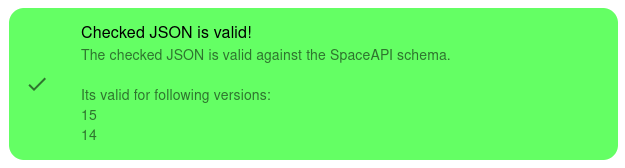

SpaceAPI directory
==================

The SpaceAPI directory is a list of spaces that have the SpaceAPI
implemented.

If your space is missing in the [list](./directory.json), [fork the repository](https://github.com/SpaceApi/directory),
add your space and create a pull request in GitHub.

Find more information about the SpaceAPI on [spaceapi.io](https://spaceapi.io).

Some tips for correct implementation see information about [providing a endpoint](https://spaceapi.io/provide-an-endpoint/).

If you want to use the spaceapi directory, you can find it hosted under [https://directory.spaceapi.io/](https://directory.spaceapi.io/).

## Adding a new endpoint

When adding a new endpoint make sure that:

 * [ ] The new entry is at the correct (alphabetically sorted) line. Use
   `bin/check` to verify.
 * [ ] The endpoint is valid according to <https://validator.spaceapi.io/ui>.
   It should show something like 
